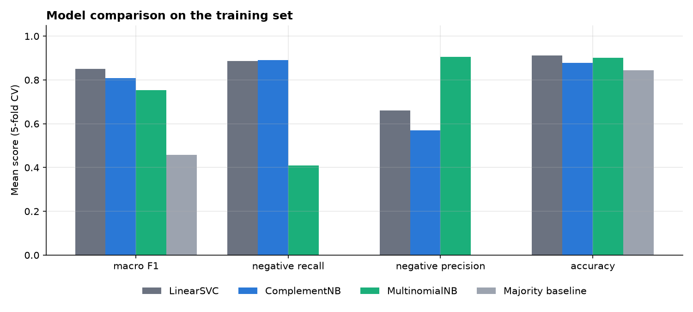
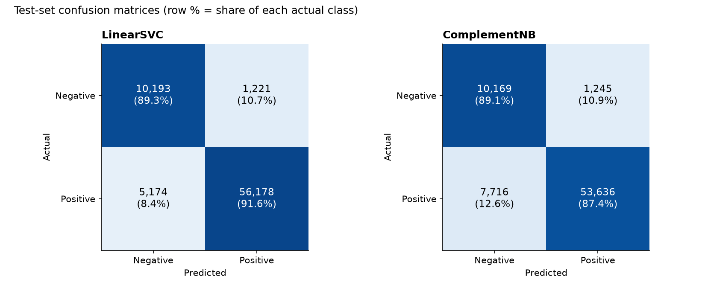
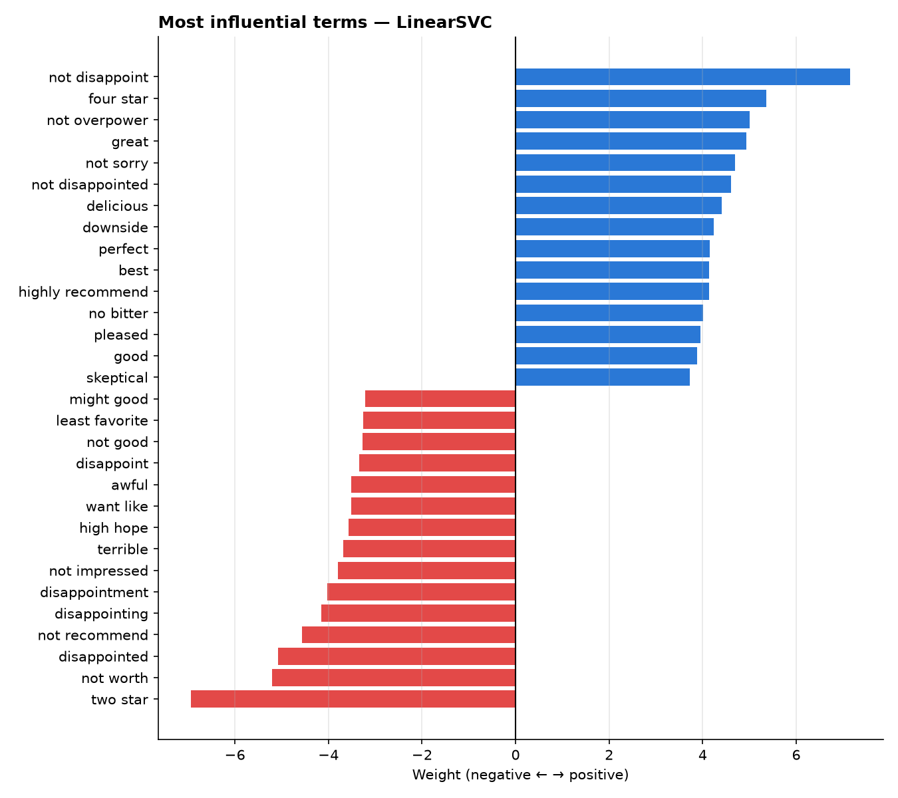

# Review Sentiment Analysis — NLP Pipeline with TF-IDF and Naive Bayes

**DecodeLabs Data Science Internship · Project 4 (2026)**

Classifies Amazon food reviews as **Positive** or **Negative** from their text alone, using a
linguistically careful pre-processing pipeline, TF-IDF features and Naive Bayes / linear SVM models.

**Ingest → Pre-process → Vectorize → Model → Evaluate → Explain**

📓 **Full walkthrough with outputs:** [`notebooks/sentiment_analysis.ipynb`](notebooks/sentiment_analysis.ipynb)

---

## Key results

Evaluated once on a held-out test set of **72,766 reviews** never seen during training or model selection.

| Model | Accuracy | Macro F1 | Negative recall | Negative precision | ROC-AUC |
|---|---|---|---|---|---|
| Majority-class baseline *(5-fold CV)* | 84.3% | 0.4574 | 0.0% | — | — |
| MultinomialNB *(5-fold CV)* | 90.1% | 0.7539 | 40.9% | 90.6% | — |
| ComplementNB | 87.7% | 0.8085 | 89.1% | 56.9% | 0.9515 |
| **LinearSVC (final model)** | **91.2%** | **0.8537** | **89.3%** | **66.3%** | **0.9656** |

- **Accuracy alone is misleading here:** always predicting *Positive* already scores 84.3%, so models
  were selected by **macro F1**.
- **ComplementNB detects 89.1% of negative reviews vs 40.9% for MultinomialNB** — on imbalanced
  data it is clearly the better Naive Bayes variant.
- **The final LinearSVC finds 89.3% of unhappy customers** with the best macro F1 (0.8537) and is
  stable across folds (macro F1 standard deviation 0.0003).





## Why keeping negations matters

Standard stop-word lists remove *not*, *no* and *nor*, which turns "I am **not** happy" into "happy".
A custom list (`standard − negations`, built with set operations) keeps them, which produced
**336 negation bigrams** among the 10,000 features. The model relies on them heavily:

| Pushes toward Negative | Weight | Pushes toward Positive | Weight |
|---|---|---|---|
| not worth | −5.21 | not disappoint | +7.15 |
| not recommend | −4.57 | not overpower | +5.00 |
| not impressed | −3.79 | not sorry | +4.69 |
| not good | −3.27 | not disappointed | +4.60 |
| not happy | −3.08 | no bitter | +4.01 |



## Method

### 1. Data — 568,454 → 363,829 reviews

| Step | Reviews |
|---|---|
| Raw file | 568,454 |
| 3-star (neutral) reviews removed | 525,814 |
| Texts that appear with both labels removed | 525,797 |
| Duplicate texts removed | 363,831 |
| Reviews with no tokens left after pre-processing | 363,829 |

**Labels:** 4–5 ★ = Positive, 1–2 ★ = Negative. **Class balance:** 84.3% Positive / 15.7% Negative.
30.8% of the review texts were duplicates; they are removed **before** the train/test split so
the model is never tested on a review it has already seen.

### 2. Pre-processing (NLTK)

| Step | Detail |
|---|---|
| Character normalization | HTML entities decoded, HTML tags (`<br />`, in 25.5% of reviews) and links removed, lower-casing |
| Negation handling | `don't` → `do not`, `can't` → `can not`, `won't` → `will not` |
| Tokenization | `word_tokenize` |
| POS tagging | Perceptron tagger on the full sentence, before any token is removed |
| Filtering | punctuation, numbers, 1-letter tokens and custom stop-words removed |
| Lemmatization | `WordNetLemmatizer` with Treebank → WordNet POS mapping (`went` → `go`, `better` → `good`) |

Pre-processing runs in parallel with `joblib` and is cached to `data/processed/`.

### 3. Vectorization

TF-IDF with unigrams + bigrams, `max_features=10,000`, `min_df=2`, fitted on the training set only.
The 291,063 × 10,000 training matrix is stored as a **SciPy CSR sparse matrix: 129.5 MB instead of
21.69 GB dense (171× smaller)** — 99.6% of its cells are zero.

### 4. Modelling

- Stratified 80/20 train/test split.
- 5-fold stratified cross-validation on the training set, with TF-IDF refitted inside every fold
  (no leakage).
- `MultinomialNB(alpha=1.0)` and `ComplementNB(alpha=1.0)` — Laplace smoothing; `LinearSVC` with
  balanced class weights as a reference model.

## Limitations

- **Star ratings are noisy labels.** Some reviews contradict their rating, e.g. a 5 ★ review stating
  "I would not recommend it to my worst enemy". Several of the model's most confident errors are
  cases like this, so 100% accuracy is not achievable on this data.
- **Precision–recall trade-off.** Balanced class weights let the model catch 89.3% of negative
  reviews, but about one in three reviews it flags as Negative is actually Positive (precision 66.3%).
- **Bag-of-words.** Word order beyond two-word phrases is not modelled: "Great price, but my dog would
  not eat it" is scored slightly Positive. Phrases such as *two star* and *four star* rank among the
  strongest features because some reviewers write their rating in the text.
- The model is binary; neutral (3 ★) reviews are forced into one of the two classes.
- The data covers 1999–2012 food reviews; performance on other products or more recent text is untested.

## Project structure

```
├── data/raw/README.md                   # dataset source and download steps (CSV not in repo)
├── notebooks/sentiment_analysis.ipynb   # complete pipeline with outputs
├── models/sentiment_pipeline.joblib     # fitted TF-IDF + LinearSVC pipeline
├── reports/
│   ├── figures/                         # all charts produced by the notebook
│   └── metrics.json                     # data counts, CV and test metrics
├── requirements.txt
└── README.md
```

The saved pipeline expects text that has already passed through `preprocess_batch` (notebook section 6.5).

## How to run

```bash
git clone https://github.com/nadiagul01/review-sentiment-analysis.git
cd review-sentiment-analysis

python -m venv .venv
# Windows:      .venv\Scripts\activate
# macOS/Linux:  source .venv/bin/activate
pip install -r requirements.txt
```

1. Download `Reviews.csv` from
   [Kaggle](https://www.kaggle.com/datasets/snap/amazon-fine-food-reviews) into `data/raw/`.
2. Open `notebooks/sentiment_analysis.ipynb`, select the `.venv` kernel and **Run All**.
   NLTK resources are downloaded automatically on the first run. Pre-processing took 13.5 minutes
   on 7 CPU cores; later runs load the cached result.

## Dataset

J. McAuley and J. Leskovec. *From amateurs to connoisseurs: modeling the evolution of user expertise
through online reviews.* WWW, 2013. [SNAP: Amazon Fine Food Reviews](https://snap.stanford.edu/data/web-FineFoods.html)

## Tech stack

Python · pandas · NumPy · SciPy (CSR) · NLTK (tokenization, POS tagging, WordNet) · scikit-learn
(TF-IDF, MultinomialNB, ComplementNB, LinearSVC, Pipeline) · joblib · Matplotlib · Jupyter
